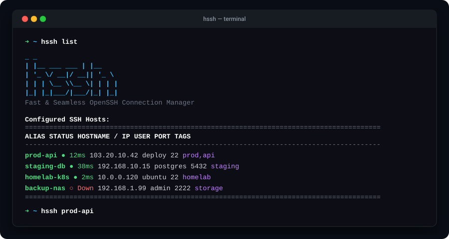

<div align="center">

# HSSH

### Fast & Seamless OpenSSH Connection Manager

[](https://opensource.org/licenses/MIT)
[](https://golang.org)
[](https://github.com/ilhammmaulana/hssh)

Configure host aliases, run parallel TCP latency checks, and deploy ed25519 key authentication without retyping passwords or memorizing IP addresses.

[Documentation Website](file:///mnt/Workspace/Tools/docs/index.html) • [Installation](#-installation) • [Quickstart](#-quickstart) • [Command Reference](#-command-reference)

---

### Terminal Preview



</div>

---

## Key Capabilities

- **Single Static Binary**: Compiled via Go standard library with zero runtime dependencies. Boots in under 2ms.
- **Concurrent TCP Latency Checks**: Probes all configured servers in parallel via non-blocking TCP dials, bypassing ICMP firewall restrictions.
- **Multi-Platform**: Native builds for Linux (`amd64`, `arm64`), macOS (Apple Silicon & Intel), and Windows (PowerShell & CMD).
- **Automatic Ed25519 Key Setup**: Generates and transfers keys to remote `authorized_keys` with automatic fallback piping on Windows.
- **Pre-Write Backups**: Creates an atomic timestamped backup (`~/.ssh/config.bak.<timestamp>`) prior to every write or delete.
- **Standard OpenSSH Compliance**: Writes directly to `~/.ssh/config`. Compatible with native `ssh`, VS Code Remote SSH, and Ansible.

---

## 📦 Installation

### Linux (Ubuntu, Debian, Arch, Fedora, Alpine)
```bash
curl -fsSL https://raw.githubusercontent.com/ilhammmaulana/hssh/main/install.sh | bash
```

### macOS (Apple Silicon M1/M2/M3/M4 & Intel)
```bash
curl -fsSL https://raw.githubusercontent.com/ilhammmaulana/hssh/main/install.sh | bash
```

### Windows (PowerShell)
```powershell
irm https://raw.githubusercontent.com/ilhammmaulana/hssh/main/install.ps1 | iex
```

### Go Install
```bash
go install github.com/ilhammmaulana/hssh@latest
```

---

## ⚡ Quickstart

### 1. Launch Interactive Dashboard
```bash
hssh
```

### 2. Add Server
Add a host using guided interactive prompts, or in a single command:
```bash
hssh add prod-api 103.20.10.42 deploy 22
```

### 3. Connect Directly
```bash
hssh prod-api
```

---

## 📖 Command Reference

| Command | Arguments | Description | Example |
|---|---|---|---|
| `hssh` | — | Launches interactive host dashboard (ctop-style) | `hssh` |
| `hssh list` / `ls` | — | Interactive host table with live latency pings | `hssh ls` |
| `hssh list-plain` / `lp` | — | Plain text table without TUI (script friendly) | `hssh lp` |
| `hssh list-fast` / `lf` | — | Fast listing without network ping checks | `hssh lf` |
| `hssh <alias>` | `<alias>` | Direct shortcut to launch SSH connection | `hssh prod-api` |
| `hssh add` | `[alias] [ip] [user] [port]` | Adds new host & deploys passwordless key | `hssh add box 1.2.3.4 root 22` |
| `hssh ping` | `[alias]` | Measures TCP socket round-trip time | `hssh ping prod-api` |
| `hssh test` | `[alias]` | Tests passwordless login status non-interactively | `hssh test prod-api` |
| `hssh edit` | `[alias]` | Interactively edits server parameters and tags | `hssh edit prod-api` |
| `hssh copy-key` | `[alias]` | Copies public key with universal fallback piping | `hssh copy-key prod-api` |
| `hssh backup` | — | Manually creates timestamped snapshot of `~/.ssh/config` | `hssh backup` |
| `hssh remove` / `rm` | `[alias]` | Safely removes server with automated backup | `hssh rm old-box` |
| `hssh keygen` | — | Generates modern `ed25519` key pair | `hssh keygen` |

---

## 🎮 Interactive TUI Controls (ctop-style)

When running `hssh` or `hssh list`:

| Key | Action |
|---|---|
| **`↑ / ↓`** or **`k / j`** | Navigate between servers |
| **`Enter`** | Open Host Actions Modal (**Connect**, **Edit**, **Delete**, **Copy Key**) |
| **`c`** | Immediately connect via SSH |
| **`e`** | Edit selected host configuration (IP, user, port, tags) |
| **`d`** | Delete selected host entry |
| **`k`** | Copy public key to remote host |
| **`a`** | Add a new server |
| **`r`** | Refresh parallel live latency checks |
| **`q`** or **`Esc`** | Exit dashboard |

---

## 🔒 Security Specifications

1. **One-Way Cryptographic Trust**: Only your public key (`id_ed25519.pub`) is sent to remote machines. Your private key remains local on your workstation. A remote server cannot connect back into your workstation using your public key.
2. **Local-Only Architecture**: Zero telemetry, external analytics, or cloud relays.
3. **Strict UNIX Permissions**: Applies `0700` to `~/.ssh` and `0600` to `~/.ssh/config` and private keys.
4. **Pre-Write Backups**: Automatic timestamped copies safeguard against manual formatting errors.

---

## 🛠️ Building from Source

```bash
git clone https://github.com/ilhammmaulana/hssh.git
cd hssh/god-ssh-src
go build -ldflags="-s -w" -o ../hssh .
```

---

## 📄 License

MIT License — Copyright (c) 2026 Ilham Maulana.
